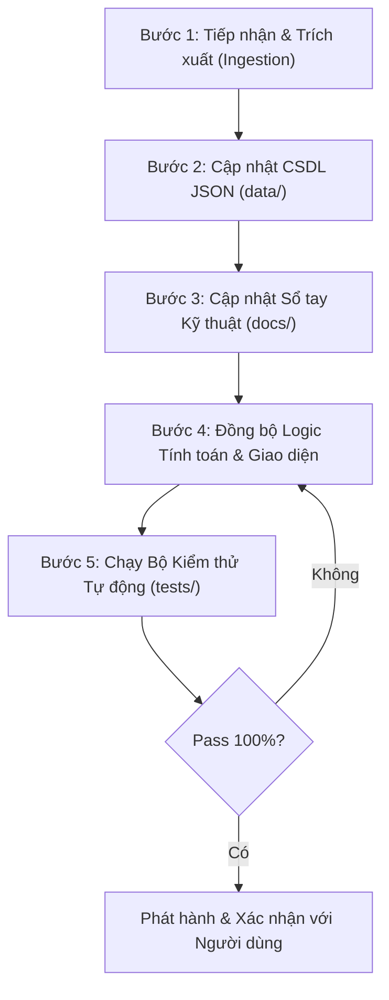

# QUY TRÌNH PHÁT TRIỂN & HƯỚNG DẪN MỞ RỘNG DỰ ÁN
*(Antigravity Standard Development Architecture & Extension Runbook)*

> Bản tài liệu này quy định chuẩn mực phát triển phần mềm, quy trình bổ sung tài liệu kỹ thuật mới, và cơ chế kiểm soát chất lượng (QA) nhằm đảm bảo hệ thống không bao giờ xảy ra sai sót khi mở rộng.

---

## 1. KIẾN TRÚC TỔNG THỂ DỰ ÁN (PROJECT STRUCTURE)

```
D:\Google Antigravity\Xich tai nang\
├── .agents/                               # CẤU HÌNH ANTIGRAVITY WORKSPACE
│   ├── rules/                             # Bộ quy tắc kiểm soát mã lệnh và cơ khí
│   │   ├── engineering_rules.md           # Quy tắc dung sai, hình học, tiếp tuyến xích
│   │   ├── cad_dxf_rules.md               # Quy tắc xuất file CAD DXF R12, bảng mã, layer
│   │   └── project_workflow.md            # Quy trình tiếp nhận & cập nhật tài liệu mới
│   └── skills/                            # Các kĩ năng Antigravity chuyên biệt
│       └── kettenwulf-engine/             # Kỹ năng kiểm toán & tính toán hình học KettenWulf
│           └── SKILL.md
├── docs/                                  # HỆ THỐNG TÀI LIỆU KỸ THUẬT ĐỘC LẬP (SSOT)
│   ├── KETTENWULF_ENGINEERING_HANDBOOK.md # Sổ tay cơ khí tổng hợp đầy đủ từ PDF
│   ├── STANDARDS_AND_PROFILES.md          # Chi tiết 4 tiêu chuẩn răng (KWN 001, 015, 017, 016)
│   ├── CHAIN_SERIES_CATALOG.md            # Danh mục kích thước chi tiết mọi dòng xích
│   ├── CAD_DXF_SPECIFICATION.md           # Bản đặc tả 5 chế độ xuất DXF và font chữ
│   └── ARCHITECTURE_AND_DEV_GUIDE.md      # Quy trình này
├── data/                                  # CƠ SỞ DỮ LIỆU CẤU TRÚC JSON (Single Source of Truth)
│   ├── standards_matrix.json              # Ma trận phân cấp: Tiêu chuẩn -> Dòng -> Mẫu -> Bước
│   ├── chain_catalogs.json                # Kích thước chi tiết từng model xích
│   ├── tooth_profile_rules.json           # Quy tắc và công thức hình học hốc răng
│   ├── din6885_keys.json                  # Kích thước then bằng DIN 6885
│   └── pitch_circle_table.json            # Bảng tra vòng chia d0 chuẩn xác 100%
├── tests/                                 # BỘ KIỂM THỬ TỰ ĐỘNG CHỐNG HỒI QUY (Automated QA Suites)
│   ├── test_geometry_consistency.py       # Kiểm toán công thức d0, df, da, ds, r1, r2, beta, gamma
│   ├── test_chain_roller_clearance.py     # Kiểm toán khe hở ăn khớp con lăn (chống va đập)
│   ├── test_dxf_syntax_and_layers.py      # Kiểm toán tính toàn vẹn và không lỗi font file DXF
│   └── run_all_tests.py                   # Lệnh chạy toàn bộ test
├── tools/                                 # CÔNG CỤ TỰ ĐỘNG HÓA
│   ├── verify_with_ezdxf.py               # Kiểm định file DXF với ezdxf engine
│   └── capture_views.py                   # Chụp ảnh màn hình kiểm chứng qua Chrome CDP
├── Tai Lieu/                              # LƯU TRỮ TÀI LIỆU GỐC (PDF, PNG trích xuất)
└── index.html                             # Web App chính của Studio
```

---

## 2. QUY TRÌNH 5 BƯỚC TIẾP NHẬN TÀI LIỆU MỚI (5-STEP INGESTION SOP)

Khi người dùng cung cấp thêm tài liệu mới (tiêu chuẩn mới, catalog mới, thông số xích đặc chủng), **BẮT BUỘC** thực hiện nghiêm ngặt theo 5 bước sau:



### Bước 1: Tiếp nhận & Trích xuất dữ liệu gốc
- Đặt file tài liệu (PDF, bản vẽ) vào thư mục `Tai Lieu/`.
- Dùng công cụ PyMuPDF trích xuất toàn bộ bảng số liệu, công thức, hình ảnh sơ đồ mặt cắt.
- Tuyệt đối không suy diễn cảm tính số liệu; nếu tài liệu thiếu số liệu, phải ghi rõ vào ghi chú kỹ thuật.

### Bước 2: Cập nhật CSDL cấu trúc (`data/`)
- Cập nhật các bảng tương ứng trong `data/chain_catalogs.json`, `data/standards_matrix.json`, hoặc `data/tooth_profile_rules.json`.
- Định dạng JSON phải chuẩn hóa khóa: `name`, `FB`, `p_list`, `b1`, `d1`, `d3`, `d5`, `g1`, `g2`, `s`.

### Bước 3: Cập nhật Sổ tay Kỹ thuật (`docs/`)
- Bổ sung bảng thông số và công thức vào `docs/KETTENWULF_ENGINEERING_HANDBOOK.md` hoặc `docs/CHAIN_SERIES_CATALOG.md`.
- Ghi rõ nguồn gốc trang tài liệu để dễ dàng truy cứu lịch sử.

### Bước 4: Đồng bộ Logic Web App (`index.html`)
- Cập nhật ma trận chọn xích trên giao diện:
  1. Tiêu chuẩn biên dạng răng (`selStandard`)
  2. Dòng xích tiêu chuẩn (`selChainSeries`)
  3. Mẫu xích (`selChainModel`)
  4. Bước xích tiêu chuẩn (`selStandardPitch`)
- Kiểm tra tính tương thích của bộ renderer Canvas 2D và bộ xuất DXF.

### Bước 5: Chạy Bộ Kiểm thử Tự động Chống Hồi Quy
- Chạy script `python tests/run_all_tests.py`.
- Mọi bài kiểm tra (tính toán hình học, khe hở con lăn, cấu trúc file DXF) phải đạt kết quả **PASS 100%** thì mới bàn giao cho người dùng.
